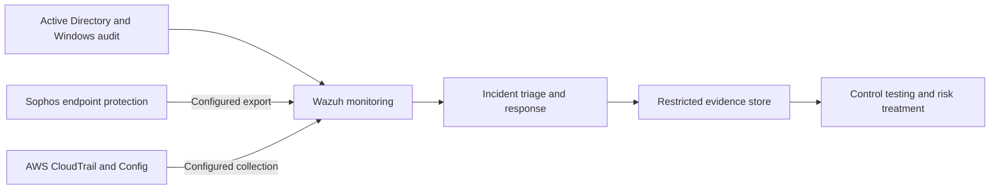

# SOC 2 + ISO 27001 Control Toolkit

An access review can be signed off while an account still has administrator rights. This project follows that
kind of gap from the control requirement through the evidence, test result and risk treatment.

The scope is SOC 2 **CC6, CC7 and CC8**, mapped to relevant **ISO/IEC 27001:2022 Annex A** controls.
There are 14 control records and 35 individual mapping relationships. The environment design uses Active Directory,
Sophos, Wazuh and AWS. The examples are synthetic; this repository does not represent a deployed environment or a completed audit.

## Walk through one finding

Start with [SYN-AR-002 in the access review](examples/access-review.csv). A contractor account has
AdministratorAccess. The reviewer selected Remove on October 12, but the record has no verified removal by
October 24. The five-business-day deadline in the example policy has passed.

| Record | What to look for |
| --- | --- |
| [CTL-003: control matrix](control-matrix/control-matrix.csv) | Owner, review frequency, required evidence and remediation |
| [Mapping relationships](control-matrix/mapping-relationships.csv) | CC6.3 maps Direct to A.5.18; the privilege and duty-separation relationships are Partial |
| [EV-003: evidence record](examples/control-evidence/ev-003.md) | A review decision exists; removal evidence does not |
| [TST-003: test result](examples/control-test-results.csv) | Fail, because the removal is overdue and unverified |
| [RSK-001: risk register](examples/risk-register.csv) | Residual risk remains Critical until treatment is verified |

The useful part of the mapping is reusing the roster and approval records. Each framework still needs its own
assessment of scope and sufficiency. Direct means the objectives align; it does not mean one requirement satisfies the other.

## Environment design



AD provides account and group records. Sophos contributes endpoint protection and response records.
CloudTrail records selected AWS activity; Config supplies supported resource configuration history and findings.
Wazuh collects configured telemetry and raises alerts. Account, endpoint and cloud owners carry out response actions.

The [architecture diagram](diagrams/architecture.md) shows collection paths and provider responsibilities.
The [evidence workflow](diagrams/control-evidence-workflow.md) shows where evidence is reviewed, rejected or sent for retesting.

## Files to use

| Area | Files |
| --- | --- |
| Control mapping | [Readable matrix](control-matrix/README.md), [full CSV](control-matrix/control-matrix.csv), [relationships](control-matrix/mapping-relationships.csv), [ISO references](control-matrix/iso-reference-catalog.csv) |
| Evidence and tests | [Evidence checklist](templates/audit-evidence-checklist.csv), [test procedures](templates/control-testing-procedures.csv), [evidence index](evidence/README.md) |
| Reusable forms | [Access review](templates/access-review.csv), [risk register](templates/risk-register.csv), [change request](templates/change-request.md), [incident record](templates/incident-record.md), [test record](templates/test-execution-record.md) |
| Incident response | [Runbook](docs/incident-response-runbook.md) and [worked case](examples/incident-record.md) |
| Sample records | [Evidence pack](examples/README.md): access reviews, risks, changes, logs, findings and test outcomes |
| Background | [Mapping method](docs/mapping-methodology.md), [operating assumptions](docs/operating-model.md), [risk scoring](docs/risk-methodology.md), [glossary](docs/glossary.md), [sources](docs/sources.md) |
| Review notes | [Interview walkthrough](docs/interview-guide.md), [validation report](docs/delivery-report.md), [GitHub instructions](docs/publishing.md) |

```text
control-matrix/   Control records and mapping rationale
templates/        Reusable review, risk, incident, change and test forms
examples/         Synthetic records, including failures and missing evidence
evidence/         Fixture hashes and a custody example
docs/             Methods, runbook, assumptions and review notes
diagrams/         Architecture and evidence workflow
scripts/          Validation and fixture manifest utilities
tests/           Validator regression tests
.github/         Validation workflow
```

## Use the templates

Read the [template instructions](templates/README.md), then copy the forms into a restricted working area.
Replace the example scope, owners, review dates and service targets with approved values. The frequencies,
deadlines and retention period here are project assumptions, not requirements imposed by either framework.
Keep real logs, personal data, credentials and confidential supplier reports out of this repository.

## Run the checks

Python 3.10+; no third-party packages:

```powershell
python scripts/validate.py
python -m unittest discover -s tests -v
```

The validator checks files, local links, tables, IDs, mapping consistency, risk calculations, synthetic labels
and evidence hashes. The tests deliberately break records to check that the validator catches the errors.
See [validation details](scripts/README.md) for the checks and their limits.

## Scope and next steps

This covers a selected control set, not all SOC 2 criteria or a complete ISO ISMS. The publisher editions were
checked, but the references and mapping judgments still need review against authorized full framework texts.
A hash check does not establish evidence provenance, and a synthetic test outcome does not establish live effectiveness.
This toolkit provides no audit opinion, compliance guarantee or certification.

The next step is an authorized lab: verify the collection paths, reconcile complete source populations and
test the controls over time. After that, expand the mapping based on the service's risks and build a complete
Statement of Applicability. Those activities have not been completed here.

[MIT license](LICENSE). Framework names and third-party material retain their respective rights.
