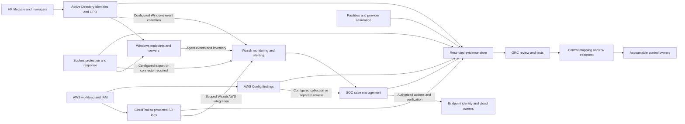

# Proposed architecture and data flow

**Design only. No deployment or live connector is claimed.**

Telemetry detects events; source systems enforce controls. GRC reviews evidence rather than claiming enforcement.
Production logs remain in protected source/evidence stores; only fabricated examples belong in public Git.
Sophos and AWS Config paths require explicit configuration and product/permission review. AWS supplies provider
infrastructure assurance while customer owners configure their workloads and review inherited-control dependencies.
