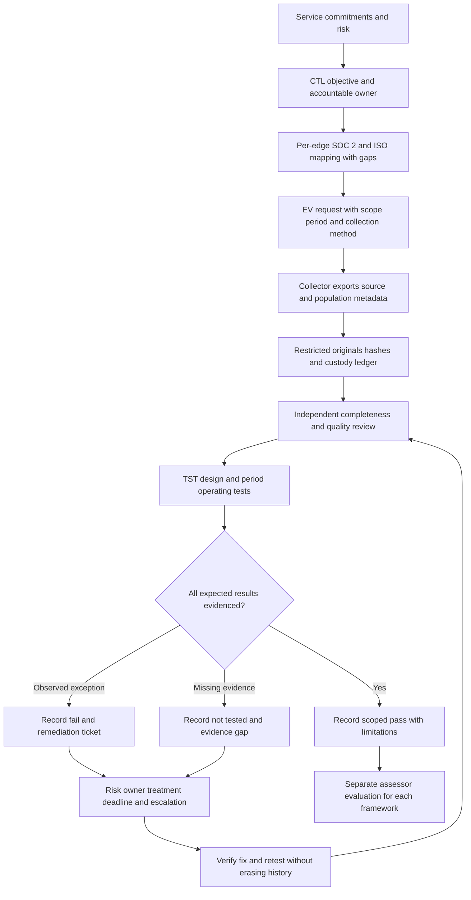

# Control-to-evidence workflow

Worked example: CTL-003 → CC6.3 / A.5.18 (Direct) → EV-003 → SYN-AR-002 → TST-003 Fail → RSK-001.
The reviewer found a removal decision but no closure evidence; the residual risk remains Critical until verified treatment.
Reuse the roster and approval evidence across frameworks only when scope, period and evidence quality fit both assessments.
